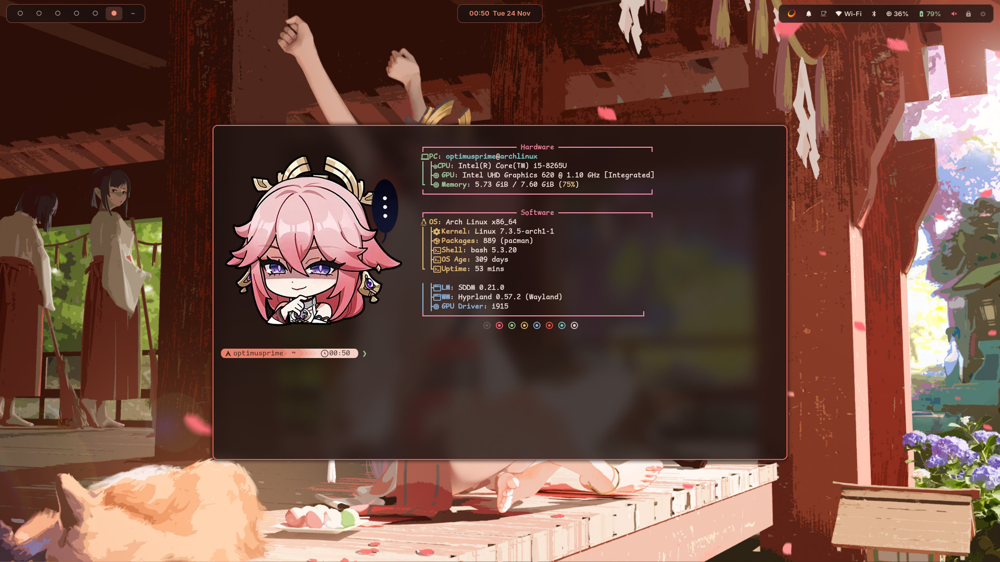
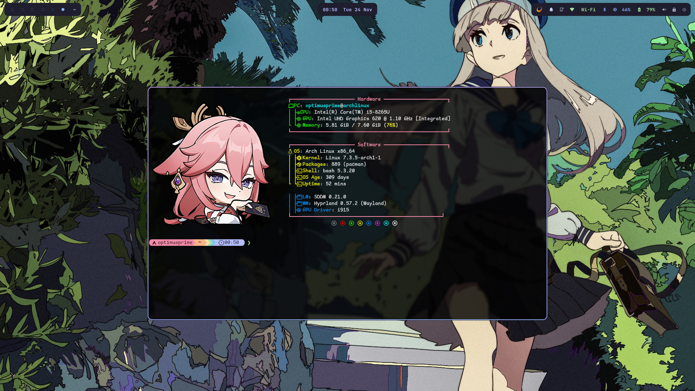
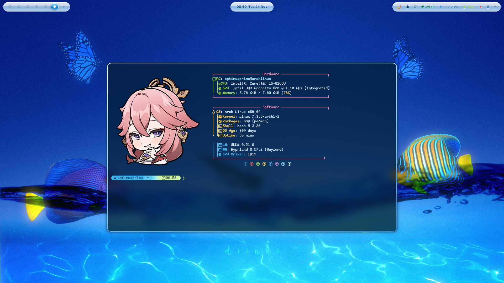

# dotfiles

Ma configuration Arch Linux + Hyprland : barre, lanceur, notifications,
terminal, écran de verrouillage, et un système de thèmes qui bascule tout
l'environnement en une commande.

Le dépôt **est** le dossier `~/.config`. Comme ce dossier contient surtout de
l'état d'applications (caches, sessions, jetons), le `.gitignore` ignore tout
par défaut et ne ré-inclut que les dossiers écrits à la main.

## Contenu

| Dossier | Rôle |
|---|---|
| `hypr/` | Hyprland (`hyprland.lua`), hyprlock, hypridle, menu de session |
| `waybar/` | Barre : config des modules et petits scripts de clic |
| `rofi/` | Lanceur d'applications et menus |
| `dunst/` | Notifications |
| `kitty/` | Terminal |
| `bash/` | `bashrc` (lié à `~/.bashrc` par `install.sh`) |
| `starship/` | Prompt |
| `tmux/` | Multiplexeur de terminal |
| `fastfetch/` | Infos système à l'ouverture d'un terminal, avec un sticker tiré au hasard |
| `themes/` | Les thèmes et `theme-switch` — voir [`themes/README.md`](themes/README.md) |

La config Neovim vit dans un dépôt séparé.

## Installation

Le dépôt se clone à la place de `~/.config` ; mets ton dossier actuel de côté
s'il existe déjà.

```bash
mv ~/.config ~/.config.bak        # seulement s'il existe
git clone https://github.com/ClementLegros/dotfiles.git ~/.config
~/.config/install.sh
```

`install.sh` crée les liens symboliques vers les fichiers qui doivent vivre
hors de `~/.config` (`~/.bashrc`, `~/.local/bin/theme-switch`). Il est
relançable sans risque : un fichier déjà présent est renommé en `.bak-<date>`,
jamais écrasé.

### Programmes attendus

Rien n'est installé automatiquement. La config s'appuie sur :

- **Session** : hyprland, hyprpaper, hyprlock, hypridle, hyprpolkitagent
- **Interface** : waybar, rofi, dunst, kitty, nemo
- **Popups de la barre** : impala (Wi-Fi, avec iwd), bluetui (Bluetooth),
  wiremix (son, avec PipeWire/WirePlumber)
- **Utilitaires** : cliphist, wl-clipboard, hyprshot, brightnessctl, playerctl,
  power-profiles-daemon
- **Shell** : starship, zoxide, fastfetch, tmux
- **Polices** : Inter, JetBrainsMono Nerd Font
- **Curseur** : Bibata-Modern-Ice, pour le thème Frutiger Aero (paquet AUR
  `bibata-cursor-theme-bin`, ou l'archive du projet
  [Bibata_Cursor](https://github.com/ful1e5/Bibata_Cursor/releases) extraite
  dans `~/.local/share/icons/`). Sans lui, le thème retombe sur Adwaita.

## Thèmes

```bash
theme-switch              # thème actif + liste
theme-switch sakura       # bascule et recharge à chaud
```

Trois thèmes sont fournis : `catppuccin`, `frutiger-aero` et `sakura`. Chaque
programme inclut en permanence un fichier sous `themes/current/`, un lien
symbolique vers le thème actif ; changer de thème revient à repointer ce lien.
Le détail est dans [`themes/README.md`](themes/README.md).

### Sakura



### Catppuccin



### Frutiger Aero



## Raccourcis principaux

`Super` est la touche de modification.

| Raccourci | Action |
|---|---|
| `Super + Q` | Terminal |
| `Super + R` | Lanceur d'applications |
| `Super + E` | Gestionnaire de fichiers |
| `Super + C` | Fermer la fenêtre |
| `Super + F` | Plein écran |
| `Super + V` | Fenêtre flottante / tuilée |
| `Super + Maj + V` | Historique du presse-papier |
| `Super + L` | Verrouiller |
| `Super + M` | Menu de session (veille, redémarrage, extinction) |
| `Super + flèches` | Changer de fenêtre active |
| `Super + S` | Espace de travail temporaire |
| `Impr écran` | Capture d'une zone |

La liste complète est dans `hypr/hyprland.lua`.

## Crédits

Rien de tout cela n'est de moi :

- les stickers de `fastfetch/yae-miko/` viennent des « Paimon's Paintings »
  de Genshin Impact (© HoYoverse) ;
- le fond d'écran du thème Sakura est une illustration de Yae Miko dont je ne
  connais pas l'auteur, tirée d'un fond Wallpaper Engine.
- les fonds d'écran des thèmes Catppuccin et Frutiger Aero sont eux aussi des
  images récupérées, dont je ne suis pas l'auteur.
